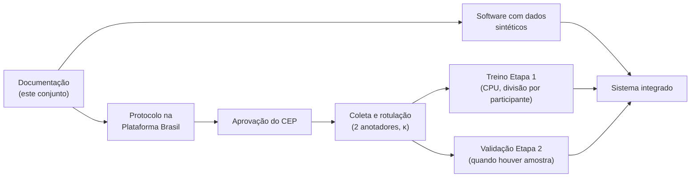

# 01 — Visão e contexto do projeto

Documento de referência obrigatória antes de qualquer novo módulo (`CLAUDE.md`,
Regra 2). Todas as afirmações têm fonte em
[07-fundamentos-pesquisa.md](07-fundamentos-pesquisa.md), que também revisa o
levantamento bibliográfico de agosto de 2026.

## 1. Problema

O diagnóstico do Transtorno do Espectro Autista (TEA) é clínico e, no Brasil, a
triagem precoce na atenção primária usa instrumentos como o M-CHAT (16 a 30
meses). A dermatoglifia — o estudo das cristas da pele, formadas na vida fetal e
estáveis depois — é investigada há décadas como possível marcador de alterações
do neurodesenvolvimento. A hipótese do projeto é que características das
impressões digitais **carreguem algum sinal estatístico** associado ao TEA.

## 2. O que a evidência permite afirmar

| Afirmação | Situação na literatura |
|---|---|
| Discordância de padrões entre dedos homólogos das duas mãos é maior no TEA | **Único achado de ponta de dedo replicado** (de Bruin et al. 2014, d = 0,55; Kyselicová et al. 2023, p = 0,0026) — ambas amostras só de meninos |
| Frequência de verticilos, arcos, arcos tendidos ou alças muda no TEA | Achados em **direções opostas** entre estudos; nenhum padrão isolado é marcador confiável |
| Contagem de cristas é menor no TEA | Apoio parcial; outros estudos não encontram diferença |
| Ângulo atd distingue TEA | Variável **palmar** — não mensurável com 10 digitais; achados inconsistentes |
| Existe acurácia diagnóstica conhecida (sensibilidade, AUC) | **Nenhum estudo publicado** relata; não há meta-análise |
| Dermatoglifia serve para diagnosticar TEA | Os próprios autores primários rejeitam esse uso |

Duas referências do levantamento anterior **não foram localizadas** como citadas
(o artigo do "Pabna Medical College Journal, jul. 2026" sobre ângulo atd e o
"Journal of Anatomical Sciences, Nigéria 2022") e não devem ser usadas no TCC
até que o PDF original seja conferido. A revisão de Pranika et al. (2025) e o
estudo de Kazemi et al. (2017) foram confirmados com ressalvas metodológicas.

## 3. Objetivo do sistema

> Construir um **protótipo de pesquisa auditável** que transforma as 10
> impressões digitais de um participante em indicadores dermatoglíficos
> mensuráveis — padrão de cada dedo e discordância bilateral — usando uma CNN
> treinada localmente, e que permita **testar, com método adequado, se esses
> indicadores carregam sinal** associado ao TEA.

O sistema **não** diagnostica nem faz triagem de TEA. Um resultado negativo bem
medido também é um resultado válido para o TCC.

### Objetivos específicos
1. Site em que médicos do protocolo cadastram participantes, registram o
   consentimento e enviam as 10 digitais.
2. CNN em Keras, baseada na estrutura do `modelo_arroz_keras.py`, que classifica
   o padrão de cada dedo (Etapa 1, ADR-0002).
3. Cálculo determinístico dos indicadores (contagens, discordância bilateral).
4. Modelo tabular interpretável que estima um escore (Etapa 2), ativado só depois
   de validado com divisão por participante.
5. Rastreabilidade completa: versão do modelo, consentimento, auditoria.

## 4. Escopo

| Dentro | Fora |
|---|---|
| 10 digitais por participante, uma imagem por dedo | Impressão palmar (atd, a-b, pregas, hipotênar) |
| Classificação em 5 padrões e conversão ulnar/radial | Contagem automática de cristas (pós-MVP, sem método validado nas fontes) |
| Indicadores de contagem e discordância | Diagnóstico, triagem populacional, uso clínico de rotina |
| Escore complementar após validação | Integração direta com SDK de leitor (pós-MVP) |
| Médicos vinculados ao protocolo do CEP | Acesso de pacientes, responsáveis ou público |

## 5. Partes interessadas

| Parte | Interesse |
|---|---|
| Nicolas Damasceno (autor) | Desenvolver o sistema e o TCC com rigor técnico e ético |
| Orientador (pesquisador responsável) | Submeter o protocolo ao CEP; responder pela pesquisa |
| Médicos do protocolo | Coletar dados com pouca fricção e ver indicadores explicáveis |
| Participantes e responsáveis | Sigilo, consentimento livre, poder retirar a participação |
| CEP da instituição | Proteção de população vulnerável (crianças; pessoa com TEA é pessoa com deficiência pela Lei 12.764/2012) |

## 6. Restrições éticas e regulatórias (resumo)

| Norma | Consequência para o sistema |
|---|---|
| Res. CNS 466/2012, Res. CNS 738/2024, Lei 14.874/2024 | **Nenhuma digital real antes da aprovação do CEP** (Plataforma Brasil). TCLE do responsável e TALE da criança. Guarda mínima de 5 anos |
| LGPD (Lei 13.709/2018) | Digital vinculada a pessoa é dado biométrico sensível; o escore é dado de saúde. Consentimento específico e destacado do responsável (art. 11, I + art. 14, §1º). Dados **pseudonimizados**, não anonimizados. RIPD como anexo do TCC |
| RDC 657/2022 e 751/2022 (Anvisa) | O software é SaMD, em princípio Classe II; dispensado de notificação **só dentro da investigação**, sem comercialização nem outros usos |
| Res. CFM 2.454/2026 | IA só como apoio; médico é o responsável final; registrar uso de IA no prontuário; informar o paciente, que pode recusar; IA não comunica diagnóstico |
| PL 2338/2023 | **Não é lei** (situação em 20/10/2026); citado apenas como tendência |
| Lei 12.764/2012 (Lei Berenice Piana — mesma lei) | Diagnóstico é clínico; nenhuma norma admite biomarcador como critério |

Itens ainda não verificados em fonte primária (texto oficial da Res. CFM
2.454/2026, enquadramento da instituição como "órgão de pesquisa", entre outros)
estão listados na seção final do documento 07.

## 7. Ordem de execução

O desenvolvimento do site e do código de treino segue em paralelo com dados
sintéticos; o modelo treinado com dados reais é a última peça.

## 8. Critérios de sucesso do TCC

- Sistema funcional nos fluxos UC01–UC08 com dados sintéticos e, após o CEP, reais.
- Etapa 1 avaliada com divisão por participante, matriz de confusão e recall por
  classe (meta de referência da literatura: ≈89–91% em 5 classes).
- Etapa 2 (se houver amostra): sensibilidade, especificidade com IC 95%, ROC-AUC,
  PR-AUC, VPP/VPN em prevalência declarada e calibração, conforme TRIPOD+AI.
- Limitações declaradas: amostra, sexo, método de captura, ausência de ponto de corte.

## 9. Glossário

| Termo | Significado |
|---|---|
| Arco / arco tendido | Padrão sem delta / com elevação central em "tenda" |
| Alça (presilha) ulnar / radial | Alça que se abre para o lado do dedo mínimo / do polegar; depende da mão |
| Verticilo | Padrão circular ou espiral, com dois deltas |
| Discordância bilateral | Número de pares de dedos homólogos (mesmo dedo nas duas mãos) com padrões diferentes |
| Etapa 1 / Etapa 2 | CNN de padrões / modelo tabular de escore (ADR-0002) |
| Pseudonimização | Separar identificação de dados, com ligação guardada à parte (LGPD art. 13, §4º) |
| SaMD | Software como dispositivo médico (RDC 657/2022) |
| TCLE / TALE | Termo de consentimento do responsável / de assentimento da criança |
