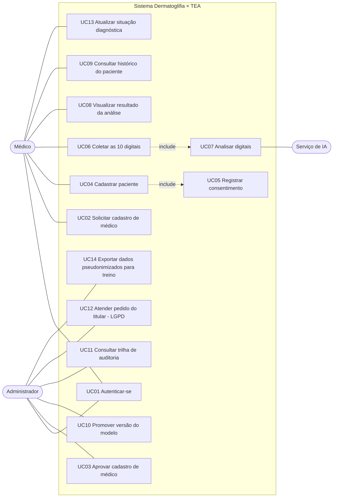

# 03 — Casos de uso

Escopo da primeira versão (MVP): **UC01 a UC07**. Os demais ficam registrados para
as versões seguintes. Requisitos e regras de negócio citados (RF, RNF, RN) estão
em [02-requisitos.md](02-requisitos.md).

## Atores

| Ator | Tipo | Descrição |
|---|---|---|
| **Médico** | Primário | Profissional com CRM ativo, **membro da equipe do protocolo de pesquisa aprovado pelo CEP**, cadastrado e aprovado no sistema. Cadastra pacientes, coleta digitais e consulta resultados. |
| **Administrador** | Primário | Responsável pelo sistema (no TCC, o próprio autor/orientador). Aprova médicos e promove versões do modelo. |
| **Serviço de IA** | Secundário (sistema) | Serviço Python que carrega o modelo de `modelo_producao/` e devolve a análise das 10 digitais. |

O paciente e seu responsável legal **não** acessam o sistema; eles participam
fora dele (consentimento assinado, coleta presencial).

> **Contexto de uso.** O sistema é um protótipo de pesquisa. Pela RDC 751/2022
> (art. 2º, §8º), um software com essa finalidade só fica dispensado de
> notificação/registro na Anvisa enquanto usado dentro da investigação aprovada,
> sem comercialização nem uso para outros fins. Por isso o acesso é restrito a
> médicos do protocolo e os resultados não orientam decisão clínica. Fontes em
> [07-fundamentos-pesquisa.md](07-fundamentos-pesquisa.md).

## Diagrama de casos de uso

> Mermaid não tem diagrama de casos de uso nativo; o fluxograma acima usa a
> notação equivalente (atores à esquerda/direita, `include` tracejado).

---

## UC01 — Autenticar-se

| | |
|---|---|
| **Ator** | Médico, Administrador |
| **Pré-condição** | Usuário com cadastro **ativo** (RN01). |
| **Pós-condição** | Sessão autenticada com token de acesso; acesso registrado na auditoria. |
| **Requisitos** | RF01, RNF03, RNF05 |

**Fluxo principal**
1. O usuário informa e-mail e senha.
2. O sistema valida as credenciais e o status do cadastro.
3. O sistema emite um token de acesso com o papel do usuário (MEDICO ou ADMIN).
4. O sistema registra o login na trilha de auditoria e direciona para a tela inicial.

**Fluxos alternativos**
- 2a. Credenciais inválidas → mensagem genérica ("e-mail ou senha incorretos"), sem indicar qual campo errou; tentativa registrada.
- 2b. Cadastro pendente de aprovação ou inativo → acesso negado com a mensagem correspondente.
- 2c. Cinco tentativas falhas seguidas → bloqueio temporário da conta (RNF05).

---

## UC02 — Solicitar cadastro de médico

| | |
|---|---|
| **Ator** | Médico (ainda não cadastrado) |
| **Pós-condição** | Cadastro criado com status `PENDENTE`. |
| **Requisitos** | RF02, RN01 |

**Fluxo principal**
1. O médico informa nome, e-mail, senha, CRM, UF do CRM e especialidade.
2. O sistema valida formato dos campos, força da senha e unicidade de e-mail e de CRM+UF.
3. O sistema cria o usuário com status `PENDENTE` e avisa que o acesso depende de aprovação.

**Fluxos alternativos**
- 2a. E-mail ou CRM+UF já cadastrados → mensagem informando que já existe cadastro.

---

## UC03 — Aprovar cadastro de médico

| | |
|---|---|
| **Ator** | Administrador |
| **Pré-condição** | Há cadastro `PENDENTE`. |
| **Pós-condição** | Cadastro `ATIVO` ou `RECUSADO`; decisão auditada. |
| **Requisitos** | RF03, RN01 |

**Fluxo principal**
1. O administrador lista os cadastros pendentes.
2. Confere o CRM no portal público do Conselho Federal de Medicina e se o médico consta da equipe do protocolo aprovado pelo CEP (verificações manuais, fora do sistema).
3. Registra o vínculo com o protocolo e aprova, ou recusa registrando o motivo.

**Fluxos alternativos**
- 2a. Médico não pertence ao protocolo → recusa obrigatória (uso fora da investigação não é permitido).

---

## UC04 — Cadastrar paciente

| | |
|---|---|
| **Ator** | Médico |
| **Pré-condição** | Médico autenticado. |
| **Pós-condição** | Paciente cadastrado e vinculado ao médico responsável. |
| **Requisitos** | RF04, RN05, RNF06 |

**Fluxo principal**
1. O médico informa: nome, data de nascimento, sexo biológico, nome, parentesco e contato do responsável legal (obrigatório para menores de 18 anos).
2. O sistema valida os dados e grava em duas partes: o **paciente pseudônimo** (identificador, sexo, situação diagnóstica `SUSPEITA`, médico responsável) e a **identificação** (nome, nascimento, responsável) em área separada do banco.
3. **Inclui UC05** — o consentimento deve ser registrado antes de qualquer coleta.

**Fluxos alternativos**
- 1a. Paciente menor de idade sem responsável informado → o sistema impede o cadastro.

**Por que cada dado é coletado** (minimização, LGPD art. 6º, III): sexo e idade
entram como covariáveis porque contagens dermatoglíficas variam por sexo e os
estudos de TEA são quase todos com meninos (ver doc 07); os dados do responsável
são exigidos para o consentimento de menores. Nenhum outro dado é pedido.

---

## UC05 — Registrar consentimento

| | |
|---|---|
| **Ator** | Médico |
| **Pré-condição** | Paciente cadastrado; termo assinado em papel ou meio eletrônico. |
| **Pós-condição** | Consentimento registrado com versão do termo, data e escopo. |
| **Requisitos** | RF05, RN03, RN07 |

**Fluxo principal**
1. O médico seleciona o tipo de termo: TCLE (paciente adulto ou responsável legal) e, quando aplicável, TALE (assentimento da criança/adolescente).
2. Informa a versão do termo aprovada pelo CEP, a data de assinatura e marca, separadamente:
   - **autoriza a análise** das digitais pelo sistema e reconhece que ela não é diagnóstico (obrigatório para coletar);
   - **está ciente do uso de IA** como apoio ao médico, podendo recusar (obrigatório; Res. CFM 2.454/2026);
   - **autoriza o uso das digitais no treino/validação de modelos** (opcional e independente).
3. O sistema registra o consentimento.

**Fluxos alternativos**
- 3a. Análise não autorizada → o sistema não libera a coleta (UC06).
- 3b. Revogação posterior → o consentimento recebe data de revogação; dados deixam de ser usados para o escopo revogado (UC12).

---

## UC06 — Coletar as 10 digitais

| | |
|---|---|
| **Ator** | Médico |
| **Pré-condição** | Paciente com consentimento clínico válido (RN03). |
| **Pós-condição** | Sessão de coleta `COMPLETA` com 10 digitais, ou `INCOMPLETA` com justificativa. |
| **Requisitos** | RF06, RF07, RN02, RN09, RNF01, RNF02 |

**Fluxo principal**
1. O médico inicia uma sessão de coleta; o sistema registra método de captura, tipo de impressão (rolada, preferencial) e dispositivo definidos no protocolo, além da idade em meses.
2. O sistema apresenta os 10 dedos em ordem fixa: polegar, indicador, médio, anelar e mínimo da mão direita; depois os mesmos da mão esquerda.
3. Para cada dedo, o médico envia a imagem capturada (ver ADR-0004).
4. O sistema valida formato, resolução mínima e tamanho; calcula o hash; armazena a imagem cifrada; marca o dedo como coletado.
5. O médico pode refazer a imagem de qualquer dedo antes de concluir.
6. Com os 10 dedos coletados, o médico conclui a sessão.
7. **Inclui UC07** — a análise é solicitada automaticamente.

**Fluxos alternativos**
- 4a. Imagem fora do padrão (formato, resolução, tamanho) → rejeitada com a orientação do problema.
- 4b. Dedo impossível de coletar (amputação, lesão, malformação) → o médico registra "não coletável" e o motivo; a sessão termina `INCOMPLETA` e **não** é analisada no MVP (RN09).
- 4c. Sessão abandonada → permanece `EM_ANDAMENTO` e pode ser retomada ou cancelada.

---

## UC07 — Analisar digitais

| | |
|---|---|
| **Ator** | Sistema (disparado por UC06); Serviço de IA |
| **Pré-condição** | Sessão `COMPLETA`; existe um modelo ativo. |
| **Pós-condição** | Análise `CONCLUIDA` vinculada à sessão e à versão do modelo, ou `ERRO`. |
| **Requisitos** | RF08, RN06, RNF04 |

**Fluxo principal**
1. O back-end cria a análise com status `PENDENTE`.
2. Envia ao Serviço de IA apenas as 10 imagens identificadas por mão/dedo, o sexo e a idade em meses — **sem nome ou identificadores** do paciente.
3. O Serviço de IA classifica o padrão de cada dedo, converte alças esquerda/direita em ulnar/radial pela mão, calcula os indicadores derivados (contagens por padrão, discordância bilateral) e, só se houver modelo da Etapa 2 validado, o escore; caso contrário o escore volta nulo (ADR-0002, RN10).
4. O back-end grava os resultados por dedo, os indicadores e o escore, com a versão do modelo que respondeu.
5. A análise passa a `CONCLUIDA`.

**Fluxos alternativos**
- 2a. Serviço de IA indisponível ou tempo esgotado → análise `ERRO` com mensagem; o médico pode solicitar nova tentativa.
- 3a. O serviço sinaliza imagem de baixa qualidade → análise concluída com alerta de qualidade no dedo correspondente.

---

## UC08 — Visualizar resultado da análise

| | |
|---|---|
| **Ator** | Médico |
| **Pré-condição** | Análise `CONCLUIDA` de paciente vinculado ao médico (RN05). |
| **Requisitos** | RF09, RN04 |

**Fluxo principal**
1. O médico abre a análise.
2. O sistema exibe:
   - o **aviso fixo**: "Protótipo de pesquisa, não validado clinicamente e não aprovado pela Anvisa. Não constitui diagnóstico nem triagem de TEA e não substitui a avaliação clínica nem instrumentos validados como o M-CHAT.";
   - a informação de que **não existe ponto de corte validado** e, para pacientes do sexo feminino, de que a literatura quase não tem dados de meninas;
   - o padrão previsto e a confiança de cada um dos 10 dedos;
   - os indicadores derivados (contagem de verticilos, arcos, alças; discordância entre mãos);
   - o escore, somente quando a Etapa 2 estiver validada (RN10), e sempre a versão do modelo com suas métricas de validação;
   - alertas de qualidade de imagem, se houver.
3. O médico pode registrar uma observação sobre o resultado.
4. O médico confirma que registrou no prontuário o uso da IA como apoio (Res. CFM 2.454/2026); o sistema guarda a data dessa confirmação.

---

## UC09 — Consultar histórico do paciente *(pós-MVP)*

O médico vê as sessões de coleta e análises anteriores do paciente, em ordem
cronológica, com a versão de modelo de cada uma.

## UC10 — Promover versão do modelo *(pós-MVP)*

O administrador registra uma nova versão (arquivo, hash, métricas de teste) e a
marca como ativa; a anterior é desativada mas mantida para rastreabilidade.
No MVP isso é feito manualmente conforme `modelo_producao/README.md`.

## UC11 — Consultar trilha de auditoria *(pós-MVP)*

O administrador filtra os eventos de acesso por usuário, paciente, ação e período.

## UC12 — Atender pedido do titular (LGPD) *(pós-MVP)*

O administrador, a pedido do titular ou responsável, exporta, corrige ou elimina
os dados de um paciente, ou registra a revogação de um consentimento. A
eliminação apaga as imagens armazenadas e anonimiza os registros de análise.

## UC13 — Atualizar situação diagnóstica *(pós-MVP, prioridade alta)*

Quando o diagnóstico clínico do paciente é concluído fora do sistema, o médico
atualiza a situação de `SUSPEITA` para `TEA_CONFIRMADO` ou `TEA_DESCARTADO` e
informa a fonte (ex.: avaliação multiprofissional). Sem esse dado não é possível
medir, no futuro, se os indicadores têm relação com o diagnóstico real.

## UC14 — Exportar dados pseudonimizados para treino *(pós-MVP)*

O administrador exporta, para a máquina de treino, apenas imagens e atributos
(identificador pseudônimo, mão, dedo, sexo, idade em meses, situação diagnóstica)
de participantes com `autoriza_uso_treino = true`. Nome, data de nascimento e
responsável nunca são exportados. A exportação é registrada na auditoria.
