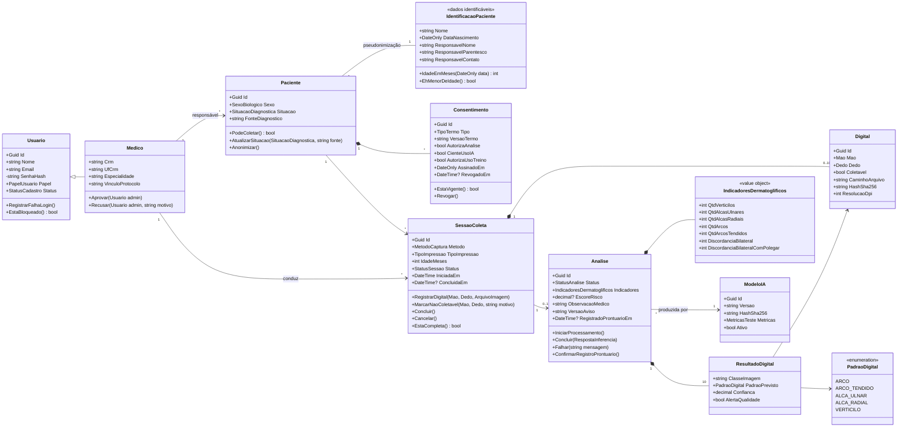
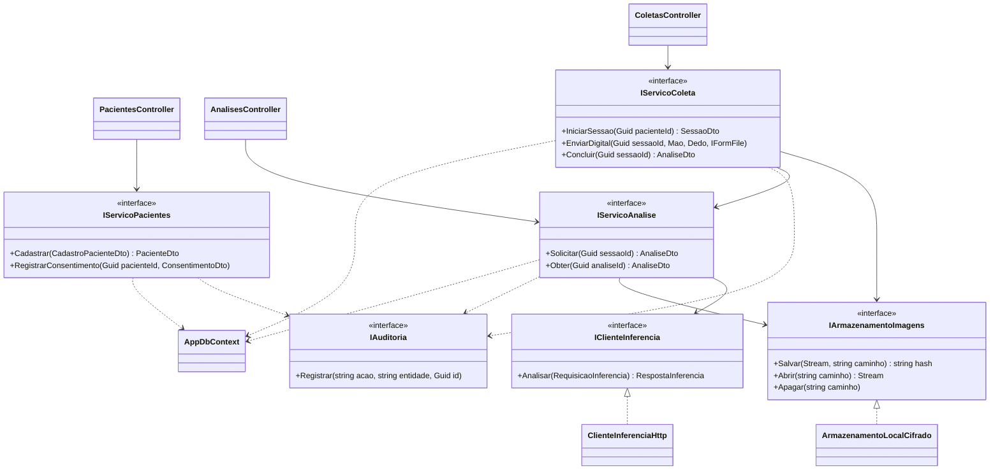
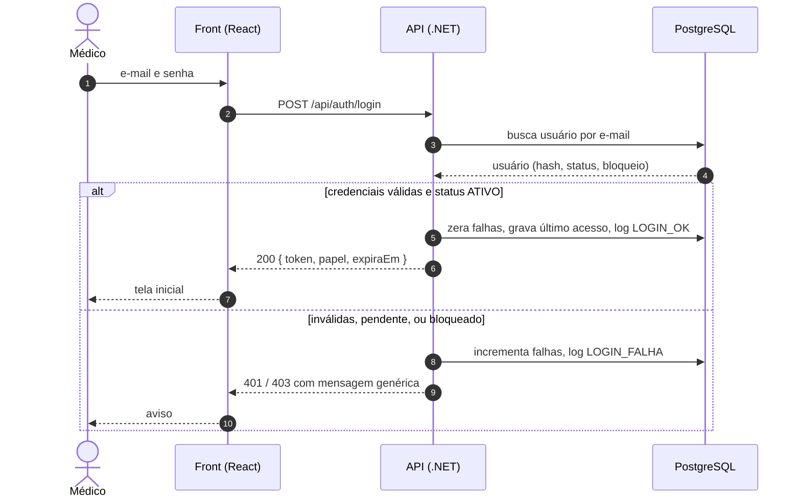
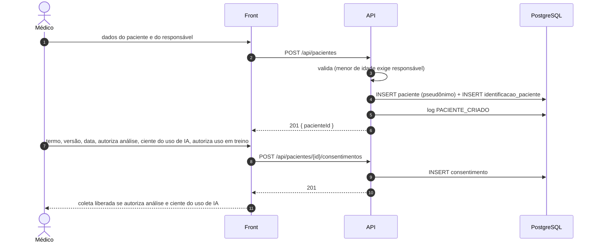
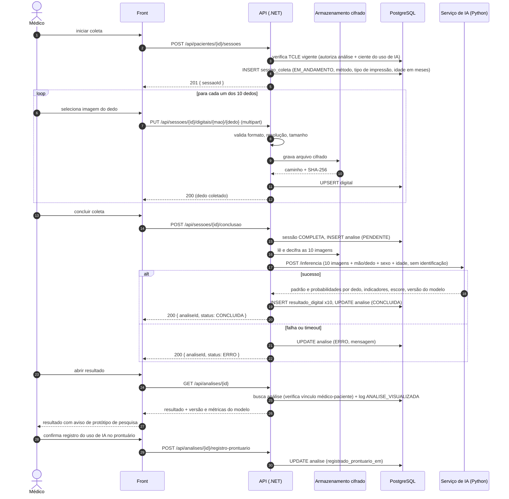
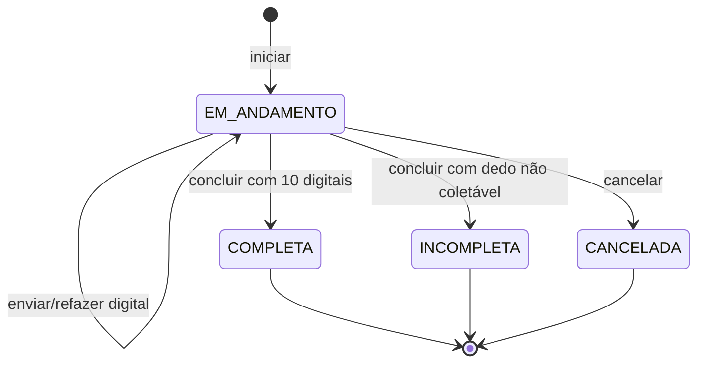
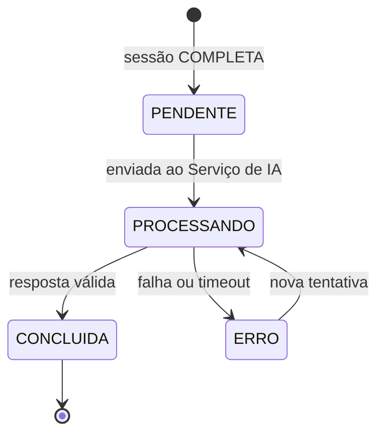

# 04 — Diagramas UML

Diagramas em Mermaid (renderizam no GitHub). Nomes do domínio em português,
como definido no `CLAUDE.md`.

## 1. Diagrama de classes do domínio (back-end .NET)

> No banco, `Medico` é uma tabela 1-para-1 com `usuario` (ver doc 05); no código
> a herança é a forma mais direta de expressar que todo médico é um usuário.
> `IdentificacaoPaciente` fica separada de `Paciente` para que biometria e
> resultados só conheçam o identificador pseudônimo (LGPD art. 13, §4º).

## 2. Classes de serviço (camadas do back-end)

As interfaces isolam o que muda: o cliente de inferência pode trocar de HTTP para
ONNX dentro do .NET (ADR-0001) e o armazenamento pode trocar de disco local para
outro destino sem afetar os serviços.

## 3. Sequência — autenticação (UC01)

## 4. Sequência — cadastro do paciente e consentimento (UC04 + UC05)

## 5. Sequência — coleta das 10 digitais e análise (UC06 + UC07 + UC08)

A chamada ao Serviço de IA é **síncrona** no MVP: são 10 imagens pequenas e a
inferência de uma CNN desse porte cabe em poucos segundos mesmo em CPU. Se o
tempo crescer, a análise passa para uma fila em segundo plano sem mudar o
contrato com o front (o status `PENDENTE/PROCESSANDO` já existe para isso).

## 6. Estados — sessão de coleta

## 7. Estados — análise

