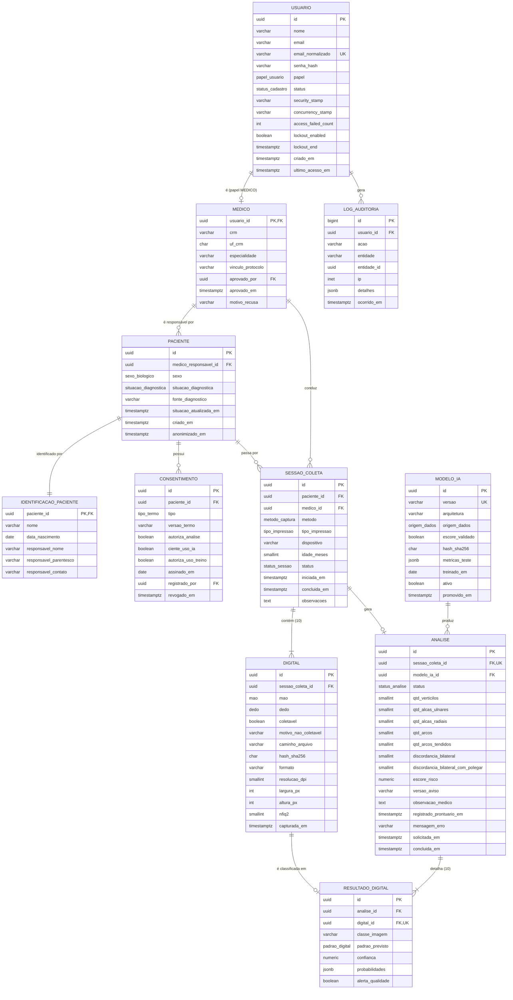

# 05 — Modelo de banco de dados

Banco relacional **PostgreSQL** (ADR-0003), acessado pelo back-end .NET via
Entity Framework Core. O Serviço de IA **não** acessa o banco. A base normativa
de cada escolha abaixo está em [07-fundamentos-pesquisa.md](07-fundamentos-pesquisa.md).

## Princípios

- **Pseudonimização (LGPD art. 13, §4º).** Dados que identificam a pessoa (nome,
  data de nascimento, responsável) ficam em `identificacao_paciente`, separados de
  biometria e resultados, que só conhecem o `uuid` do paciente. Remover o nome não
  anonimiza uma digital — por isso o conjunto é tratado como **pseudonimizado**,
  nunca como anônimo.
- **Imagens fora do banco.** O banco guarda referência ao arquivo, hash SHA-256 e
  metadados técnicos. Os arquivos ficam cifrados em disco, fora da pasta pública.
- **Minimização (LGPD art. 6º, III).** Só entra o que algum caso de uso usa. CPF,
  endereço e documentos não fazem parte do sistema.
- **Rastreabilidade.** Toda análise aponta para a versão de modelo que a produziu
  e guarda o aviso exibido ao médico.
- **Chaves `uuid`** em entidades expostas pela API; `bigint` só no log de auditoria.
- **Datas em UTC** (`timestamptz`).

## Diagrama entidade-relacionamento



## Tipos enumerados

Gravados como `varchar` com `CHECK` dos valores permitidos (ADR-0003); os nomes
abaixo identificam o conjunto de valores, não tipos nativos do PostgreSQL.

| Tipo | Valores |
|---|---|
| `papel_usuario` | `MEDICO`, `ADMIN` |
| `status_cadastro` | `PENDENTE`, `ATIVO`, `RECUSADO`, `INATIVO` |
| `sexo_biologico` | `MASCULINO`, `FEMININO` |
| `situacao_diagnostica` | `SUSPEITA`, `TEA_CONFIRMADO`, `TEA_DESCARTADO`, `CONTROLE` |
| `tipo_termo` | `TCLE`, `TALE` |
| `metodo_captura` | `LEITOR_OPTICO`, `TINTA_DIGITALIZADA` |
| `tipo_impressao` | `ROLADA`, `PLANA` |
| `status_sessao` | `EM_ANDAMENTO`, `COMPLETA`, `INCOMPLETA`, `CANCELADA` |
| `mao` | `DIREITA`, `ESQUERDA` |
| `dedo` | `POLEGAR`, `INDICADOR`, `MEDIO`, `ANELAR`, `MINIMO` |
| `status_analise` | `PENDENTE`, `PROCESSANDO`, `CONCLUIDA`, `ERRO` |
| `padrao_digital` | `ARCO`, `ARCO_TENDIDO`, `ALCA_ULNAR`, `ALCA_RADIAL`, `VERTICILO` |
| `origem_dados` | `SINTETICO`, `REAL` |

Os cinco padrões de `padrao_digital` são as categorias usadas pelos estudos de
dermatoglifia e TEA (arch, tented arch, ulnar loop, radial loop, whorl). A CNN
prevê `classe_imagem` no espaço da imagem (`ARCO`, `ARCO_TENDIDO`,
`ALCA_ESQUERDA`, `ALCA_DIREITA`, `VERTICILO`); `padrao_previsto` é o valor já
convertido para ulnar/radial pela mão registrada (ADR-0002).

## Dicionário de dados — restrições relevantes

### usuario
- Gerenciada pelo ASP.NET Core Identity (ADR-0006), com colunas renomeadas para
  o padrão do banco. `email_normalizado` é único.
- `senha_hash`: hash do `PasswordHasher` do Identity; a senha nunca é armazenada.
- `access_failed_count`, `lockout_enabled` e `lockout_end` implementam o bloqueio
  do RNF05 (5 falhas → 15 minutos).
- `security_stamp` muda quando o usuário é inativado ou troca a senha,
  invalidando tokens emitidos antes.

### medico
- `UNIQUE (crm, uf_crm)`.
- `vinculo_protocolo`: identificação do médico como membro da equipe do protocolo
  aprovado pelo CEP. Só médicos vinculados são aprovados (RN01), porque a isenção
  da RDC 751/2022 vale apenas para uso dentro da investigação.

### paciente (pseudônimo)
- Não contém nome, data de nascimento nem contato.
- `situacao_diagnostica` começa em `SUSPEITA`. Quando o diagnóstico clínico é
  fechado (por avaliação padrão, fora do sistema), o médico atualiza para
  `TEA_CONFIRMADO` ou `TEA_DESCARTADO` e informa `fonte_diagnostico`
  (ex.: "avaliação multiprofissional, DSM-5-TR"). Isso permite, no futuro, medir o
  desempenho do sistema contra o diagnóstico real. `CONTROLE` identifica
  participantes do grupo controle do protocolo.
- `anonimizado_em`: preenchido quando o titular pede eliminação (UC12).

### identificacao_paciente
- Relação 1-para-1 com `paciente`. Fica em **schema separado** (`identificacao`),
  acessível só pelo papel de banco da API; nenhuma consulta de análise faz join
  com ela, exceto a tela do próprio médico responsável.
- `responsavel_nome` obrigatório quando o paciente tem menos de 18 anos na data do
  cadastro (validado na aplicação).
- Na eliminação (UC12), a linha é apagada e as imagens removidas; os indicadores
  agregados das análises permanecem ligados apenas ao `uuid`.

### consentimento
- Coleta só é liberada com TCLE vigente (`revogado_em IS NULL`) em que
  `autoriza_analise = true` **e** `ciente_uso_ia = true` (RN03; Res. CFM 2.454/2026
  exige informar o paciente sobre o uso de IA e permitir recusa).
- `autoriza_uso_treino` é independente e opcional: só digitais com esse
  consentimento podem ser exportadas para treino/validação (RN07).

### sessao_coleta
- `idade_meses` calculada na abertura da sessão (a idade entra como covariável na
  Etapa 2 sem expor a data de nascimento ao Serviço de IA).
- `metodo_captura`, `tipo_impressao` e `dispositivo` precisam coincidir com os do
  conjunto de treino do modelo ativo; divergência gera alerta (ADR-0004).
- Índice parcial único: no máximo uma sessão `EM_ANDAMENTO` por paciente.

### digital
- `UNIQUE (sessao_coleta_id, mao, dedo)`; refazer a captura substitui o registro.
- `CHECK (coletavel OR motivo_nao_coletavel IS NOT NULL)`.
- `caminho_arquivo` relativo ao diretório de armazenamento; nunca uma URL pública.
- `nfiq2`: escore de qualidade NIST NFIQ 2 (0–100), quando calculado; nulo no MVP.

### modelo_ia
- Índice parcial único em `ativo` onde `ativo = true`: só um modelo ativo.
- `metricas_teste`: cópia de `treino/modelos/<versao>/metricas.json`.
- `origem_dados`: `SINTETICO` para o modelo de demonstração (ADR-0005), `REAL`
  para o treinado com dados da pesquisa; exibido junto do resultado.
- `escore_validado`: só `true` quando a Etapa 2 dessa versão foi validada; com
  `false`, o back-end grava `escore_risco` nulo mesmo que o serviço envie valor (RN10).

### analise
- `UNIQUE (sessao_coleta_id)` no MVP.
- `escore_risco` `numeric(5,4)`, `CHECK (escore_risco BETWEEN 0 AND 1)`; **nulo**
  enquanto não houver modelo da Etapa 2 validado (ADR-0002).
- `discordancia_bilateral`: pares homólogos — indicador, médio, anelar e mínimo —
  com padrões diferentes entre as mãos, **0 a 4, polegar excluído** (de Bruin et
  al., 2014). `discordancia_bilateral_com_polegar`: variante 0 a 5.
- `versao_aviso`: versão do texto de aviso exibido com o resultado (RN04).
- `registrado_prontuario_em`: quando o médico confirmou ter registrado no
  prontuário o uso da IA como apoio (Res. CFM 2.454/2026).

### resultado_digital
- `confianca` `numeric(5,4)` entre 0 e 1; `probabilidades` guarda a saída bruta
  da CNN nas 5 classes do espaço da imagem.

### log_auditoria
- Somente inserção (a aplicação não atualiza nem apaga linhas).
- Ações mínimas: login (sucesso/falha), aprovação de médico, criação/leitura de
  paciente, upload de digital, visualização de análise, atualização de situação
  diagnóstica, exportação e eliminação de dados.
- `detalhes` nunca contém imagem, nome de paciente ou senha.

## Retenção

Dados de pesquisa: guarda mínima de **5 anos** após o término do estudo
(Res. CNS 466/2012, XI.2 "f"; Lei 14.874/2024, art. 51); depois, eliminação ou
anonimização (LGPD art. 16). O prazo exato será o definido no protocolo do CEP.

## Onde ficam as imagens

```
<DIRETORIO_ARMAZENAMENTO>/            (fora do repositório e da pasta pública)
  <sessao_coleta_id>/
    DIREITA_POLEGAR.png.enc
    ...
    ESQUERDA_MINIMO.png.enc
```

Cifragem AES-256-GCM por arquivo; chave fora do banco e do código (ASP.NET Core
Data Protection ou `dotnet user-secrets` em desenvolvimento). Nenhum nome de
arquivo contém dado do paciente.

## Implementação (migration `Inicial`)

O modelo acima está implementado em `aplicacao/back/src/Dermatoglifia.Infraestrutura/Persistencia`
e foi aplicado e conferido num PostgreSQL 16 em 20/10/2026 (gravação e leitura
do fluxo completo, concorrência e todas as restrições abaixo).

| Aspecto | Como ficou |
|---|---|
| Nomes | `snake_case` (EFCore.NamingConventions); chaves `pk_<tabela>`, estrangeiras `fk_<tabela>_<referenciada>_<coluna>`, índices `ix_…`, únicos parciais `ux_…`, `CHECK` `ck_<tabela>_<coluna>` |
| Enums | `varchar(30)` em MAIÚSCULAS_COM_SUBLINHADO + `CHECK` dos valores (ADR-0003) |
| Concorrência | `sessao_coleta` e `analise` usam a coluna de sistema `xmin` (sem coluna extra) |
| Indicadores | colunas `qtd_*` e `discordancia_*` da própria `analise`, nulas até concluir |
| Probabilidades | `jsonb` com chaves no formato da API, ex.: `{"ARCO": 0.05, "VERTICILO": 0.8}` |
| Identity | além das colunas listadas, `usuario` tem as colunas padrão do Identity (`user_name`, `phone_number`, `two_factor_enabled` etc.), e existem `usuario_claim`, `usuario_login` e `usuario_token`; o MVP não as usa |
| Histórico de migrations | tabela `__historico_migracoes` |
| Exclusões | `paciente` não pode ser apagado com consentimentos ou sessões (`RESTRICT`); apagar a identificação acontece pela anonimização (UC12) |

