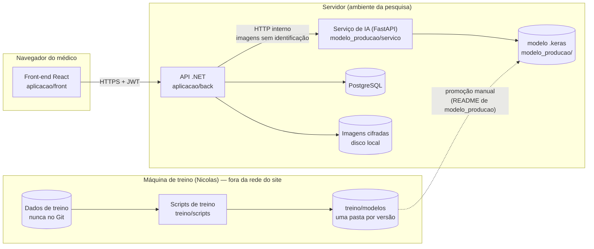

# 06 — Arquitetura do sistema

Decisões detalhadas nos ADRs: [0001](adr/0001-servico-inferencia-python.md)
(serviço de inferência), [0002](adr/0002-pipeline-ia-duas-etapas.md) (pipeline
de IA), [0003](adr/0003-banco-postgresql.md) (banco),
[0004](adr/0004-captura-por-envio-de-imagem.md) (captura).

## Visão de componentes



Pontos-chave:
- Só a API conversa com o banco, com o armazenamento e com o Serviço de IA.
- O Serviço de IA recebe imagens, mão, dedo, sexo e idade — nunca nome ou ID do paciente.
- A máquina de treino não se conecta ao site; o único elo é o arquivo do modelo,
  promovido manualmente com hash e métricas registrados.

## Organização do back-end (.NET)

Arquitetura em camadas, simples o suficiente para um TCC:

```
aplicacao/back/
  src/
    Dermatoglifia.Api/              controllers, autenticação JWT, validação de entrada
    Dermatoglifia.Aplicacao/        serviços de caso de uso (IServicoColeta, ...)
    Dermatoglifia.Dominio/          entidades, enums, regras (Paciente, SessaoColeta, ...)
    Dermatoglifia.Infraestrutura/   EF Core + Npgsql, armazenamento cifrado, cliente HTTP da IA
  tests/
    Dermatoglifia.Testes/           testes de domínio e de serviços
```

Dependências apontam para dentro: `Api → Aplicacao → Dominio`;
`Infraestrutura` implementa as interfaces de `Aplicacao`.

## Organização do front-end (React)

```
aplicacao/front/src/
  paginas/        Login, CadastroMedico, Pacientes, NovoPaciente, Coleta, Resultado
  componentes/    SeletorDedo, PreviaImagem, AvisoNaoDiagnostico, TabelaPadroes
  servicos/       cliente da API (fetch/axios + token)
  rotas/          rotas protegidas por papel
```

`AvisoNaoDiagnostico` é obrigatório em toda tela que mostre resultado (RN04) e
exibe o texto enviado pela API, para que a versão mostrada seja a registrada na análise.

O desenho detalhado do back-end está em [08-back-end.md](08-back-end.md).

## API REST — primeira versão

| Método | Rota | Papel | Caso de uso |
|---|---|---|---|
| POST | `/api/auth/login` | público | UC01 |
| POST | `/api/medicos/solicitacoes` | público | UC02 |
| GET | `/api/medicos/solicitacoes?status=PENDENTE` | ADMIN | UC03 |
| POST | `/api/medicos/{id}/aprovacao` | ADMIN | UC03 |
| POST | `/api/medicos/{id}/recusa` | ADMIN | UC03 |
| GET | `/api/pacientes` | MEDICO | lista os pacientes do médico |
| POST | `/api/pacientes` | MEDICO | UC04 |
| GET | `/api/pacientes/{id}` | MEDICO | UC04/UC09 |
| POST | `/api/pacientes/{id}/consentimentos` | MEDICO | UC05 |
| POST | `/api/pacientes/{id}/sessoes` | MEDICO | UC06 (iniciar) |
| GET | `/api/sessoes/{id}` | MEDICO | UC06 (situação dos 10 dedos) |
| PUT | `/api/sessoes/{id}/digitais/{mao}/{dedo}` | MEDICO | UC06 (enviar/refazer) |
| POST | `/api/sessoes/{id}/digitais/{mao}/{dedo}/nao-coletavel` | MEDICO | UC06 (4b) |
| POST | `/api/sessoes/{id}/conclusao` | MEDICO | UC06 → UC07 |
| GET | `/api/analises/{id}` | MEDICO | UC08 |
| POST | `/api/analises/{id}/nova-tentativa` | MEDICO | UC07 (2a) |
| PATCH | `/api/analises/{id}/observacao` | MEDICO | UC08 |
| POST | `/api/analises/{id}/registro-prontuario` | MEDICO | UC08 (CFM 2.454/2026) |
| PATCH | `/api/pacientes/{id}/situacao-diagnostica` | MEDICO | UC13 (pós-MVP) |

Regras transversais:
- Toda rota de `MEDICO` verifica se o paciente pertence ao médico logado (RN05);
  caso contrário responde `404` (não revela existência).
- Erros no formato `application/problem+json` (RFC 7807, padrão do ASP.NET Core).
- Imagens nunca são devolvidas pela API no MVP; o resultado mostra os padrões,
  não as digitais.

## Serviço de IA

| Método | Rota | Descrição |
|---|---|---|
| GET | `/saude` | modelo carregado, versão e hash |
| POST | `/inferencia` | contrato no ADR-0001 |

Fluxo interno: decodifica → escala de cinza → redimensiona (mesma função do
treino) → CNN (Etapa 1) → conversão ulnar/radial pela mão → indicadores →
Etapa 2 se houver modelo validado, senão `escore_risco: null`.

## Segurança (resumo; requisitos completos em 02-requisitos.md)

| Ameaça | Controle |
|---|---|
| Interceptação | HTTPS em toda comunicação externa |
| Vazamento do disco | Imagens cifradas (AES) com chave fora do código |
| Acesso indevido entre médicos | Verificação de vínculo médico–paciente em toda consulta |
| Força bruta no login | Bloqueio após 5 falhas; hash de senha adaptativo |
| Exposição pelo repositório | `.gitignore` + hooks; segredos fora do Git |
| Reidentificação no treino | Dados pseudonimizados; tabela de ligação separada e local |
| Reidentificação pelo modelo publicado | Pesos treinados com dados reais fora do Git, em local controlado; versão pública só com dados sintéticos (ADR-0005) |
| Uso fora do protocolo | Só médicos vinculados ao protocolo do CEP são aprovados |
| Uso não rastreado | Log de auditoria somente-inserção |

## Ambiente de desenvolvimento

- `docker compose` (a criar) com PostgreSQL e o Serviço de IA; a API e o front
  rodam pelo `dotnet run` e `npm run dev`.
- Configurações sensíveis via `dotnet user-secrets` e `.env` local; o repositório
  só terá `.env.example`.

## O que revisitar quando o sistema crescer

- Fila em segundo plano para análises (hoje síncronas).
- Armazenamento de imagens em serviço dedicado, se sair do ambiente local.
- Permitir reprocessar sessões antigas com um modelo novo (hoje uma análise por sessão).
- Exportação pseudonimizada para treino, restrita a `autoriza_uso_treino = true`.
