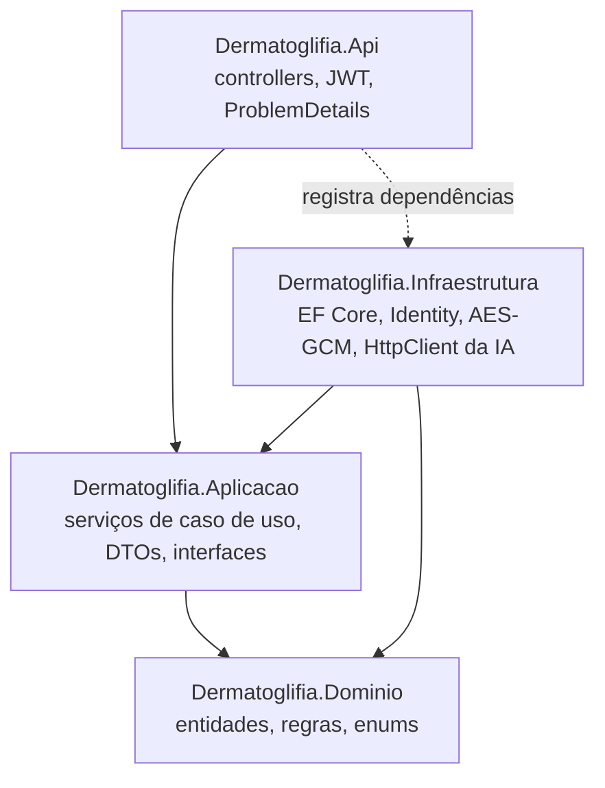
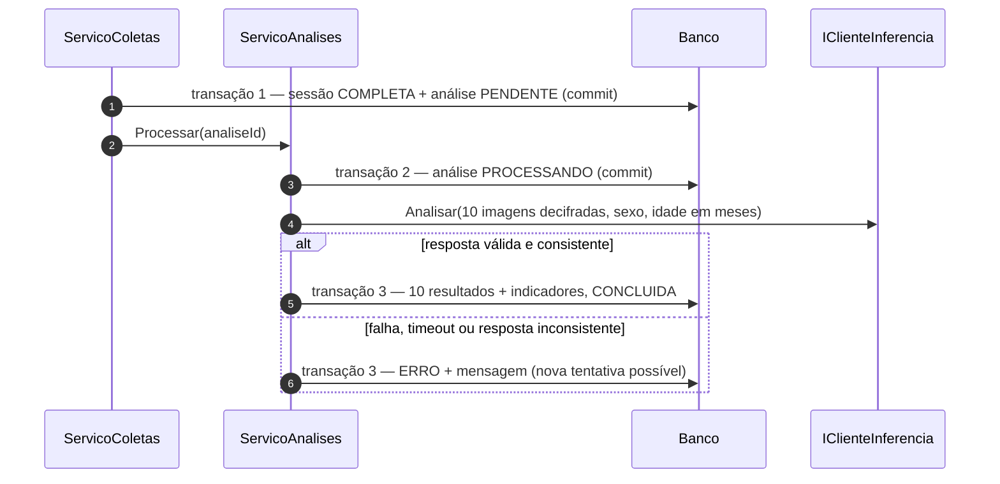
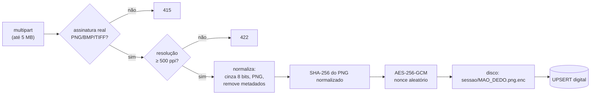

# 08 — Desenho do back-end (.NET)

Desenho detalhado da API em `aplicacao/back/`. Parte de documentos já aprovados
como base — casos de uso ([03](03-casos-de-uso.md)), UML ([04](04-uml.md)),
banco ([05](05-modelo-banco-de-dados.md)), arquitetura ([06](06-arquitetura.md))
e ADRs 0001–0006 — e não os repete: aqui está **como** construir.

## 1. Tecnologias e versões

| Item | Escolha | Motivo |
|---|---|---|
| Plataforma | **.NET 10 (LTS)** | Suporte até 14/11/2028; .NET 8 e 9 perdem suporte em 10/11/2026 |
| API | ASP.NET Core Web API com **controllers** | Estrutura explícita por recurso, alinhada aos casos de uso |
| ORM | EF Core 10 + `Npgsql.EntityFrameworkCore.PostgreSQL` 10.x | ADR-0003 |
| Autenticação | ASP.NET Core Identity (Core) + `JwtBearer` | ADR-0006 |
| Imagens | `SixLabors.ImageSharp` | Ler formato real, resolução (ppi) e converter para cinza 8 bits |
| Cifragem | `System.Security.Cryptography.AesGcm` (nativo) | AES-256-GCM sem dependência extra (RNF02) |
| Testes | xUnit + `WebApplicationFactory` + Testcontainers (PostgreSQL) | Testes de domínio rápidos e de integração com banco real |

> Licença do ImageSharp (Six Labors Split License) e versões exatas dos pacotes
> são conferidas no momento de adicioná-los e citadas na mensagem do commit.

## 2. Estrutura da solução

```
aplicacao/back/
  Dermatoglifia.sln
  src/
    Dermatoglifia.Dominio/           sem dependências externas
      Entidades/                     Usuario, Medico, Paciente, IdentificacaoPaciente,
                                     Consentimento, SessaoColeta, Digital, Analise,
                                     ResultadoDigital, ModeloIA, RegistroAuditoria
      Enums/                         Mao, Dedo, PadraoDigital, StatusSessao, ...
      ObjetosDeValor/                IndicadoresDermatoglificos, PosicaoDedo
      Excecoes/                      RegraDeNegocioException
    Dermatoglifia.Aplicacao/         casos de uso; depende só do Domínio
      Abstracoes/                    IClienteInferencia, IArmazenamentoImagens,
                                     IAuditoria, IRelogio, IUsuarioAtual
      Pacientes/  Coletas/  Analises/  Medicos/  Autenticacao/
                                     um serviço + DTOs (records) por área
    Dermatoglifia.Infraestrutura/    implementa as abstrações
      Persistencia/                  AppDbContext, configurações Fluent API, migrations
      Armazenamento/                 ArmazenamentoLocalCifrado
      Inferencia/                    ClienteInferenciaHttp
      Identidade/                    ServicoToken, configuração do Identity
    Dermatoglifia.Api/               HTTP: controllers, autenticação, ProblemDetails
      Controllers/  Configuracao/  Program.cs
  tests/
    Dermatoglifia.Dominio.Testes/
    Dermatoglifia.Aplicacao.Testes/
    Dermatoglifia.Api.Testes/        integração (banco em contêiner, IA falsa)
```



Regra: o Domínio não referencia nada; a Aplicação só conhece o Domínio e as
próprias interfaces; a Infraestrutura implementa essas interfaces; a Api monta
tudo no `Program.cs`. Isso permite testar as regras sem banco, disco ou rede.

## 3. Domínio — regras que vivem nas entidades

As entidades protegem as próprias regras: propriedades com `private set` e
métodos que validam antes de mudar estado. Violação lança
`RegraDeNegocioException` com uma mensagem para o médico.

| Entidade | Regras (RN do doc 02) |
|---|---|
| `Usuario` | `PodeAutenticar()` só com `Status = ATIVO` (RN01) |
| `Medico` | `Aprovar(admin, vinculoProtocolo)` exige vínculo preenchido e status `PENDENTE` (RN01) |
| `IdentificacaoPaciente` | Menor de 18 anos na data do cadastro exige responsável (UC04 1a) |
| `Paciente` | `PodeColetar(hoje)` exige consentimento vigente com `AutorizaAnalise` e `CienteUsoIA` (RN03) |
| `Consentimento` | `Revogar()` só uma vez; `EstaVigente()` = não revogado |
| `SessaoColeta` | Só aceita digitais em `EM_ANDAMENTO`; `Concluir()` → `COMPLETA` se os 10 dedos foram coletados, `INCOMPLETA` se algum é não coletável (RN09); mão+dedo únicos |
| `Analise` | Transições do diagrama de estados do doc 04; `Concluir()` exige 10 resultados e indicadores consistentes (seção 7) |
| `ModeloIA` | Só um ativo (garantido também por índice parcial no banco) |

`PosicaoDedo` (mão + dedo) é um objeto de valor com a ordem fixa de coleta
(direita: polegar → mínimo; depois esquerda) e o nome de arquivo
`<MAO>_<DEDO>`, usado tanto no armazenamento quanto no contrato com a IA.

## 4. Aplicação — serviços e transações

Um serviço por área, cada método é um caso de uso:

| Serviço | Métodos | UC |
|---|---|---|
| `ServicoAutenticacao` | `Entrar` | UC01 |
| `ServicoMedicos` | `SolicitarCadastro`, `ListarPendentes`, `Aprovar`, `Recusar` | UC02, UC03 |
| `ServicoPacientes` | `Cadastrar`, `Listar`, `Obter`, `RegistrarConsentimento`, `RevogarConsentimento` | UC04, UC05 |
| `ServicoColetas` | `Iniciar`, `Obter`, `EnviarDigital`, `MarcarNaoColetavel`, `Concluir` | UC06 |
| `ServicoAnalises` | `Processar`, `Obter`, `NovaTentativa`, `RegistrarObservacao`, `ConfirmarRegistroProntuario` | UC07, UC08 |

**Escopo do médico (RN05).** Toda consulta de paciente, sessão ou análise filtra
por `medico_responsavel_id = IUsuarioAtual.Id` na própria query. Recurso de outro
médico responde `404`, como se não existisse.

**Transações na conclusão da coleta.** A chamada à IA não fica dentro de uma
transação de banco aberta:



Assim uma queda no meio deixa a análise num estado visível (`PROCESSANDO` ou
`ERRO`), nunca uma sessão concluída sem análise.

**Concorrência.** `SessaoColeta` e `Analise` usam a coluna de sistema `xmin` do
PostgreSQL como *token* de concorrência otimista: dois envios simultâneos para a
mesma sessão não se sobrescrevem silenciosamente.

## 5. API — contratos

Rotas e papéis estão no doc 06. Abaixo, os contratos que definem o front.
JSON em camelCase; datas em ISO 8601 UTC; enums como texto (`"DIREITA"`).

### Autenticação
`POST /api/auth/login`
```json
{ "email": "medico@exemplo.com", "senha": "••••••••••" }
```
`200`
```json
{ "token": "eyJ...", "expiraEm": "2026-10-21T03:15:00Z",
  "usuario": { "id": "…", "nome": "Dra. Ana", "papel": "MEDICO" } }
```
`401` credenciais inválidas · `403` cadastro pendente/inativo · `423` bloqueado temporariamente.

### Pacientes
`POST /api/pacientes`
```json
{ "nome": "…", "dataNascimento": "2022-03-14", "sexo": "MASCULINO",
  "responsavel": { "nome": "…", "parentesco": "MAE", "contato": "(86) 9…" } }
```
`201` → `{ "id": "…", "podeColetar": false }` (falta o consentimento).

`POST /api/pacientes/{id}/consentimentos`
```json
{ "tipo": "TCLE", "versaoTermo": "CEP-v1.0", "assinadoEm": "2026-11-03",
  "autorizaAnalise": true, "cienteUsoIA": true, "autorizaUsoTreino": false }
```

### Coleta
`POST /api/pacientes/{id}/sessoes`
```json
{ "metodo": "LEITOR_OPTICO", "tipoImpressao": "ROLADA", "dispositivo": "…" }
```
`GET /api/sessoes/{id}` devolve o estado dos 10 dedos, na ordem de coleta:
```json
{ "id": "…", "status": "EM_ANDAMENTO",
  "dedos": [ { "mao": "DIREITA", "dedo": "POLEGAR", "situacao": "COLETADO",
               "resolucaoDpi": 500, "capturadaEm": "…" },
             { "mao": "DIREITA", "dedo": "INDICADOR", "situacao": "PENDENTE" } ] }
```
`PUT /api/sessoes/{id}/digitais/{mao}/{dedo}` — `multipart/form-data`, campo `imagem`.
`200` dedo coletado · `415` formato não aceito · `422` resolução abaixo de 500 ppi ·
`413` acima de 5 MB · `409` sessão não está em andamento.

`POST /api/sessoes/{id}/conclusao` → `200`
```json
{ "sessaoStatus": "COMPLETA", "analiseId": "…", "analiseStatus": "CONCLUIDA" }
```

### Análise
`GET /api/analises/{id}`
```json
{ "id": "…", "status": "CONCLUIDA",
  "aviso": { "versao": "v1", "texto": "Protótipo de pesquisa, não validado…" },
  "alertas": ["SEM_PONTO_DE_CORTE_VALIDADO", "POUCOS_DADOS_FEMININOS"],
  "modelo": { "versao": "2026-11-15_padroes_v1", "origemDados": "SINTETICO",
              "metricas": { "acuraciaBalanceada": 0.88 } },
  "digitais": [ { "mao": "DIREITA", "dedo": "POLEGAR", "padrao": "VERTICILO",
                  "confianca": 0.91, "alertaQualidade": false } ],
  "indicadores": { "qtdVerticilos": 4, "qtdAlcasUlnares": 5, "qtdAlcasRadiais": 0,
                   "qtdArcos": 1, "qtdArcosTendidos": 0,
                   "discordanciaBilateral": 2, "discordanciaBilateralComPolegar": 2 },
  "escoreRisco": null,
  "registradoProntuarioEm": null }
```
O texto do aviso vem do back-end (não fica fixo no front), para que a versão
exibida seja exatamente a gravada em `analise.versao_aviso`.

### Erros
Todos os erros usam `application/problem+json` (`ProblemDetails`), com `title` em
português para exibição e `errors` por campo nas validações:
```json
{ "type": "https://tcc-dermatoglifia/erros/validacao", "title": "Dados inválidos",
  "status": 400, "errors": { "responsavel.nome": ["Obrigatório para menores de 18 anos."] } }
```
| Exceção | Status |
|---|---|
| Validação de entrada (DataAnnotations) | 400 |
| `NaoEncontradoException` (inclui recurso de outro médico) | 404 |
| `ConflitoException` (e-mail/CRM repetido, sessão já em andamento) | 409 |
| `RegraDeNegocioException` | 422 |
| Falha da IA ao concluir | 200 com `analiseStatus: "ERRO"` (não é erro da requisição) |
| Inesperada | 500 sem detalhes internos; detalhe só no log |

Um `IExceptionHandler` faz esse mapeamento em um só lugar.

## 6. Pipeline de upload e armazenamento cifrado



- O formato é decidido pelos bytes iniciais (assinatura), nunca pela extensão.
- Resolução lida dos metadados da imagem; ausente → rejeita com orientação
  (o método de captura do protocolo precisa gravar a resolução).
- Arquivo cifrado: `[versão da chave: 1 byte][nonce: 12 bytes][tag: 16 bytes][dados]`.
  A versão permite trocar a chave no futuro sem perder arquivos antigos.
- Chave mestra de 256 bits em configuração secreta (`Armazenamento:Chaves:1`),
  nunca no banco nem no repositório.
- Substituir a imagem de um dedo apaga o arquivo anterior depois do commit.
- Imagens nunca são servidas pela API (doc 06).

## 7. Cliente do Serviço de IA

- `HttpClient` tipado (`ClienteInferenciaHttp`), `BaseAddress` e timeout
  (padrão 30 s, RNF04) em configuração. Uma nova tentativa automática em erro de
  rede; depois disso, a análise vai para `ERRO` e o médico pode repetir.
- Antes do envio, as 10 imagens são decifradas **em memória**; nada é gravado em
  disco temporário.
- A resposta só é aceita se passar nas verificações de consistência, feitas pelo
  back-end de forma independente:
  1. exatamente 10 resultados, um por posição mão/dedo enviada;
  2. probabilidades entre 0 e 1 somando ≈ 1;
  3. `padrao` coerente com `classe_imagem` e a mão (tabela ulnar/radial do ADR-0002);
  4. indicadores **recalculados no C#** a partir dos 10 padrões e iguais aos recebidos;
  5. `versao_modelo` cadastrada em `modelo_ia` e ativa.

  Qualquer falha → análise `ERRO` com a mensagem "resposta do modelo inconsistente".
  Isso protege contra um modelo trocado no servidor ou um erro no serviço Python.
- `escore_risco` é aceito só se `modelo_ia` indicar Etapa 2 validada; caso
  contrário é gravado nulo mesmo que venha preenchido (RN10).

## 8. Auditoria

`IAuditoria.Registrar(acao, entidade, entidadeId, detalhes)` é chamada
explicitamente pelos serviços, dentro da mesma transação da operação, para que
não exista operação sem registro. Leituras sensíveis (abrir paciente, abrir
análise) também são registradas. O IP vem do `HttpContext` via `IUsuarioAtual`.
`detalhes` passa por uma lista de campos permitidos — nunca nome, imagem ou senha.

## 9. Configuração e segredos

| Chave | Exemplo | Onde fica |
|---|---|---|
| `ConnectionStrings:Banco` | `Host=localhost;Database=dermatoglifia;…` | user-secrets / variável de ambiente |
| `Jwt:Chave` | 256 bits aleatórios em base64 | user-secrets / variável de ambiente |
| `Jwt:Emissor`, `Jwt:Audiencia`, `Jwt:ValidadeMinutos` | `dermatoglifia-api`, `…`, `60` | `appsettings.json` |
| `Armazenamento:Diretorio` | `/var/lib/dermatoglifia/imagens` | `appsettings.{Ambiente}.json` |
| `Armazenamento:Chaves:1` | 256 bits em base64 | user-secrets / variável de ambiente |
| `Inferencia:UrlBase`, `Inferencia:TimeoutSegundos` | `http://localhost:8000`, `30` | `appsettings.json` |
| `Cors:OrigensPermitidas` | `http://localhost:5173` | `appsettings.{Ambiente}.json` |
| `AdminInicial:Email`, `AdminInicial:Senha` | — | só variável de ambiente, só na primeira execução |

O repositório terá `aplicacao/back/.env.example` com as chaves e valores
fictícios. A aplicação **não inicia** se faltar `Jwt:Chave` ou
`Armazenamento:Chaves:1` (falha rápida, em vez de rodar com segredo vazio).

**Logs:** `ILogger` estruturado; corpo de requisições nunca é registrado; nomes e
contatos de pacientes nunca aparecem em log (apenas `uuid`).

## 10. Testes

| Nível | O que cobre | Exemplos |
|---|---|---|
| Domínio | Regras das entidades, sem banco | menor sem responsável é rejeitado; sessão com dedo não coletável conclui `INCOMPLETA`; transições inválidas de `Analise` |
| Aplicação | Serviços com abstrações falsas | médico não enxerga paciente de outro; resposta inconsistente da IA leva a `ERRO`; indicadores recalculados |
| Conversão ulnar/radial e indicadores | Tabelas de casos | 0–4 sem polegar e 0–5 com polegar em combinações conhecidas |
| Integração | API + PostgreSQL em contêiner + IA falsa | fluxo UC04→UC08 completo; upload com PNG sintético de 500 ppi; 401/403/404/409/413/415/422 |

Imagens de teste são **geradas no próprio teste** (ruído/padrões sintéticos com
resolução gravada); nenhuma digital real em `tests/` (RNF08).

## 11. Ordem de implementação

| Marco | Entrega | Commits esperados |
|---|---|---|
| M1 | Solução, projetos, Domínio com testes, `AppDbContext` e primeira migration | `build(back)`, `feat(back)`, `test(back)` |
| M2 | Identity + JWT, solicitação e aprovação de médico, admin inicial (UC01–UC03) | `feat(back)` |
| M3 | Pacientes, identificação separada e consentimento (UC04–UC05) + auditoria | `feat(back)` |
| M4 | Sessão de coleta, upload, normalização e cifragem (UC06) | `feat(back)` |
| M5 | Cliente da IA com serviço falso, verificação de consistência, análise (UC07–UC08) | `feat(back)` |
| M6 | ProblemDetails completo, CORS, testes de integração, `.env.example` | `feat(back)`, `test(back)` |

Cada marco termina com testes passando e o doc correspondente atualizado se algo
mudou (`CLAUDE.md`, Regra 2).
