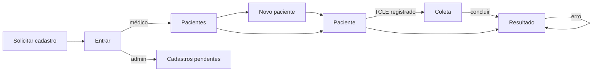

# 09 — Desenho do front-end (React)

Desenho da interface em `aplicacao/front/`. Parte dos casos de uso
([03](03-casos-de-uso.md)), da arquitetura ([06](06-arquitetura.md)) e dos
contratos da API ([08](08-back-end.md), seção 5). Stack e guarda do token no
[ADR-0007](adr/0007-stack-front-end.md).

## 1. Quem usa e para quê

| Usuário | Onde está | O que precisa da interface |
|---|---|---|
| Médico do protocolo | consultório, com o paciente e o leitor de digitais ao lado | cadastrar, registrar o consentimento, coletar os 10 dedos sem se perder, ler o resultado sem confundi-lo com diagnóstico |
| Administrador | qualquer lugar | aprovar ou recusar cadastros de médicos |

O trabalho principal da interface é **conduzir uma coleta cuidadosa e auditável**
e **apresentar um resultado de pesquisa sem exagerar o que ele significa** (RN04).

## 2. Direção visual

**Conceito: tinta sobre ficha.** O objeto mais característico deste domínio é a
**ficha decadactilar**: dez quadros, mão direita em cima e esquerda embaixo, do
polegar ao mínimo, onde as digitais sempre foram registradas. Ela é o elemento
central da interface: aparece vazia ao iniciar a coleta, é preenchida dedo a dedo
e reaparece no resultado, com o padrão de cada dedo anotado no quadro. Toda a
ousadia visual está nela; o resto é quieto e disciplinado.

### Tokens

| Token | Valor | Uso |
|---|---|---|
| `--papel` | `#F6F7F5` | fundo (papel frio, não creme) |
| `--papel-ficha` | `#FFFFFF` | interior dos quadros da ficha e dos campos |
| `--tinta` | `#1F2A44` | texto, ações principais (tinta azul-preta de carimbo) |
| `--tinta-suave` | `#4A5670` | texto secundário |
| `--linha` | `#738499` | linhas impressas da ficha, bordas de campos e de controles |
| `--linha-fina` | `#D3DAE3` | divisórias de tabela |
| `--pesquisa` / `--pesquisa-fundo` | `#7A5200` / `#FBF0D4` | **única cor de destaque**: aviso de protótipo de pesquisa |
| `--coletado` | `#2F6B4F` | dedo coletado (tinta verde) |
| `--erro` / `--erro-fundo` | `#A3261C` / `#FBE9E7` | erros |

Contraste calculado pela fórmula da WCAG 2.1 (AA): `--tinta` sobre `--papel`
13,3:1; `--tinta-suave` 6,8:1; `--pesquisa` sobre `--pesquisa-fundo` 6,1:1;
`--erro` sobre `--erro-fundo` 6,3:1; `--coletado` sobre branco 6,3:1; texto branco
em botão `--tinta` 14,3:1. `--linha` dá 3,6:1 sobre o papel e 3,8:1 sobre branco,
acima dos 3:1 exigidos para bordas de controles (critério 1.4.11); o primeiro tom
escolhido (`#8C9DB5`, 2,6:1) não passava e foi escurecido. `--linha` nunca é usada
para texto.

**Tipografia:** uma família, **Atkinson Hyperlegible Next** (variável, hospedada no
app), desenhada para baixa visão, com 0/O e 1/l/I inconfundíveis. A escolha é
funcional: o médico lê contagens, indicadores e versões de modelo. Escala modular
1,25 a partir de 1 rem (16 px): 0,8 · 1 · 1,25 · 1,563 · 1,953 rem; linhas de até
~70 caracteres; altura de linha 1,5 no corpo e 1,2 nos títulos. Algarismos
tabulares só em colunas de números a comparar (indicadores); em texto, CRM e datas
ficam os proporcionais, porque os tabulares da Atkinson parecem fonte monoespaçada.

**Forma:** raio de 3 px em campos e botões, 0 nos quadros da ficha (são linhas
impressas). Nada de sombras decorativas. Movimento só em resposta a ação (o quadro
do dedo recém-coletado recebe a marca) e desligado com `prefers-reduced-motion`.

**O que não usar:** grade de cartões arredondados com sombra, rótulos em caixa-alta,
fonte monoespaçada para dados, setas em botões, gradientes, ícones decorativos.

### Esqueleto das telas

```
┌───────────────────────────────────────────────────────────────┐
│ Dermatoglifia TEA        Pacientes            Dra. Ana  [Sair] │  barra
├───────────────────────────────────────────────────────────────┤
│ Protótipo de pesquisa — uso restrito ao protocolo aprovado... │  faixa ocre fixa
├───────────────────────────────────────────────────────────────┤
│  Título da página                                             │
│  conteúdo alinhado à esquerda, largura máxima 72 rem          │
└───────────────────────────────────────────────────────────────┘
```

Ficha decadactilar (coleta e resultado):

```
            Polegar   Indicador   Médio    Anelar   Mínimo
          ┌─────────┬──────────┬────────┬────────┬────────┐
 Direita  │  [img]  │  [img]   │   ·    │   ·    │   ·    │
          │ Coletado│ Coletado │Pendente│Pendente│Pendente│
          ├─────────┼──────────┼────────┼────────┼────────┤
 Esquerda │    ·    │    ·     │   ·    │   ·    │   ·    │
          └─────────┴──────────┴────────┴────────┴────────┘
```
Na coleta, cada quadro é um botão que abre o envio daquele dedo; o próximo dedo
pendente fica em destaque. No resultado, o quadro mostra o padrão (ex.: "Alça
ulnar") e a confiança, sem a imagem.

## 3. Rotas

| Rota | Quem | Tela | UC |
|---|---|---|---|
| `/entrar` | público | Entrar | UC01 |
| `/cadastro` | público | Solicitar cadastro de médico | UC02 |
| `/` | logado | redireciona: médico → `/pacientes`; admin → `/admin/solicitacoes` | — |
| `/admin/solicitacoes` | admin | Cadastros pendentes: aprovar ou recusar | UC03 |
| `/pacientes` | médico | Lista e busca | UC04 |
| `/pacientes/novo` | médico | Cadastrar paciente | UC04 |
| `/pacientes/:id` | médico | Paciente: dados, consentimentos, sessões; registrar TCLE/TALE; iniciar coleta | UC04, UC05 |
| `/sessoes/:id` | médico | Coleta: ficha decadactilar, envio por dedo, concluir/cancelar | UC06 |
| `/analises/:id` | médico | Resultado: aviso, alertas, ficha anotada, indicadores, observação, prontuário | UC07, UC08 |



Rota de outro papel → tela "Acesso não permitido"; sem sessão → `/entrar`,
voltando depois para a página pedida.

## 4. Telas — o essencial de cada uma

- **Entrar.** E-mail e senha. Mensagens da API exibidas como vêm (`title` do
  `problem+json`): senha errada, cadastro pendente, bloqueio, excesso de tentativas.
- **Solicitar cadastro.** Nome, e-mail, senha (repetida, para evitar erro de
  digitação), CRM, UF, especialidade. As regras do back (senha com 10+ caracteres,
  minúscula e número; CRM só com números; UF válida) são conferidas antes do envio,
  com o foco levado ao primeiro campo com erro; erros por campo (400) aparecem no
  campo e regras (409/422) no topo. Ao concluir, explica que o acesso depende de
  aprovação.
- **Cadastros pendentes (admin).** Tabela do pedido mais antigo ao mais recente;
  "Analisar" abre, logo abaixo do pedido, a decisão (aprovar com o vínculo ao
  protocolo ou recusar com o motivo). Se outro administrador decidiu antes
  (404/409/422), a mensagem aparece e a lista é recarregada.
- **Pacientes.** Tabela (nome, idade, sexo, situação, coleta liberada); busca por nome;
  estado vazio convida a cadastrar o primeiro paciente.
- **Novo paciente.** Campos do responsável aparecem obrigatórios quando a data de
  nascimento indica menor de 18 anos (a API confere de novo).
- **Paciente.** Consentimentos com estado vigente/revogado; formulário de TCLE/TALE
  com as três autorizações descritas por extenso (UC05); "Iniciar coleta" só
  habilitado com coleta liberada, explicando o motivo quando não está.
- **Coleta.** A ficha; ao escolher um dedo: arquivo, **pré-visualização local**
  (RNF13 — a imagem só existe no navegador até o envio; a API nunca a devolve),
  confirmar envio; "Dedo não pode ser coletado" com motivo; "Concluir coleta"
  habilitado com os 10 quadros resolvidos.
- **Resultado.** Ordem fixa de leitura: **aviso de protótipo** (texto vindo da API,
  RN04) → alertas → ficha anotada → indicadores com legenda → versão e origem do
  modelo → observação e confirmação de registro no prontuário. Análise com erro
  mostra a mensagem e "Tentar análise de novo".

## 5. Sessão, dados e segurança

- Token, expiração, nome e papel em `sessionStorage` (ADR-0007); sai sozinho na
  expiração e em qualquer 401, com a mensagem "Sua sessão terminou. Entre de novo.".
- Dados de pacientes ficam só na memória da aba (cache do TanStack Query), que é
  limpa ao sair.
- Imagens: pré-visualização com `URL.createObjectURL`, revogada ao trocar ou enviar;
  nunca guardada.
- Nenhum dado de paciente vai para logs do console ou para serviços de terceiros;
  nenhum script ou fonte de fora.

## 6. Erros, carregamento e vazios

- Erro da API: o `title` do `problem+json` é a mensagem (já em português, doc 08);
  `errors` por campo vão para os campos correspondentes.
- Sem conexão com a API: "Não foi possível falar com o servidor. Verifique a conexão
  e tente de novo."
- Carregamento: texto discreto no lugar do conteúdo; sem animações de esqueleto.
- Estados vazios dizem o que fazer a seguir.

## 7. Acessibilidade

WCAG 2.1 AA: contraste conferido (seção 2); foco visível em tudo (contorno de 2 px
em `--tinta`, deslocado); navegação completa por teclado, inclusive na ficha;
rótulos ligados aos campos; erros anunciados (`role="alert"`) e ligados ao campo
(`aria-describedby`); títulos de página atualizados a cada rota; nada depende só de
cor (estado do dedo também por texto); `prefers-reduced-motion` respeitado; alvo de
toque de pelo menos 44 px; uso confortável a partir de 360 px de largura.

## 8. Estrutura

```
aplicacao/front/
  index.html  vite.config.ts  eslint.config.js  tsconfig*.json
  src/
    main.tsx  App.tsx (rotas)
    estilos/        tokens.css, base.css
    api/            cliente.ts (fetch + problem+json + token), erros.ts, um módulo por recurso
    dominio/        valores da API e nomes em português (mãos, dedos, padrões)
    sessao/         sessão da aba, SessaoProvider/useSessao, RotaProtegida, destinos por papel
    componentes/    Botao, Campo, Mensagem, Layout, FichaDecadactilar, AvisoPesquisa...
    paginas/        um arquivo por tela, com seu .module.css
    testes/         setup e utilitários (render com rotas, fetch simulado, sessão sintética)
```

## 9. Testes

Vitest + Testing Library: componentes e telas renderizados com a API simulada
(`fetch` substituído nos testes), verificando o que o usuário vê e faz — textos,
rótulos acessíveis, navegação. Nenhum dado real; imagens de teste geradas na hora.

## 10. Marcos

| Marco | Entrega | Situação |
|---|---|---|
| F1 | Projeto, tokens e fonte, cliente da API, sessão, rotas protegidas por papel, layout com faixa de pesquisa, tela Entrar | Concluído: 45 testes; conferido contra a API real |
| F2 | Solicitar cadastro (UC02) e cadastros pendentes do admin (UC03) | Concluído: 63 testes no total; conferido contra a API real |
| F3 | Pacientes: lista, novo, detalhe e consentimentos (UC04, UC05) | — |
| F4 | Coleta com a ficha decadactilar (UC06) | — |
| F5 | Resultado da análise (UC07, UC08) | — |
| F6 | Revisão de acessibilidade, build de produção, ajustes de texto | — |

Telas de marcos ainda não feitos existem como reserva (`EmConstrucao`), já
protegidas pelo papel certo, para que as rotas e a navegação sejam testadas desde o F1.
