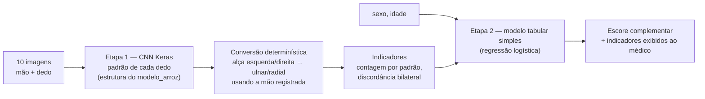

# ADR-0002: Pipeline de IA em duas etapas (padrão por dedo → indicadores → risco)

**Status:** Proposto
**Data:** 2026-10-20
**Decisores:** Nicolas Damasceno (autor), orientador do TCC

## Contexto

O sistema recebe as 10 digitais de um paciente e deve devolver ao médico uma
indicação complementar relacionada ao TEA. O modelo segue a estrutura do
`modelo_arroz_keras.py` (aulas do 3º período). Fatos que restringem a decisão
(detalhes e fontes em [`../07-fundamentos-pesquisa.md`](../07-fundamentos-pesquisa.md)):

1. **O que a literatura associa ao TEA não é uma característica de uma imagem
   isolada**, e sim contagens de padrões por dedo e a **discordância entre dedos
   homólogos das duas mãos** — o achado mais replicado (de Bruin et al. 2014,
   d = 0,55; Kyselicová et al. 2023, p = 0,0026), ambos com amostras só de meninos.
2. **Não foi encontrado estudo revisado por pares que aplique CNN diretamente a
   imagens de digitais para prever TEA.** O análogo mais próximo (esquizofrenia,
   Salvador et al. 2023, n = 1.456) chegou a AUC ≈ 0,77.
3. **Classificar o padrão de uma digital é tarefa madura:** CNNs atingem cerca de
   89–91% em 5 classes no NIST SD4 com validação rigorosa (Peralta et al. 2017) e
   ≈ 95% em 4 classes com transferência de aprendizado (Michelsanti et al. 2017).
4. **Espelhar uma digital troca o rótulo das alças:** uma alça "esquerda" vira
   "direita". Ulnar/radial depende da mão, que o sistema já registra.
5. **Não há base pública com rótulos de padrão disponível:** o NIST retirou o SD4
   de distribuição; SOCOFing e FVC2004 não têm rótulos de padrão. Os rótulos
   precisarão ser feitos pelo próprio projeto.
6. **Amostra pequena:** um TCC deve reunir dezenas, talvez poucas centenas de
   participantes — insuficiente para uma CNN aprender TEA direto da imagem.
7. **Hardware:** a Radeon RX 6600 não consta como suportada pelo ROCm; não há GPU
   do TensorFlow no Windows nativo desde a 2.10. O treino deve ser planejado em CPU.

## Decisão

Adotar um **pipeline em duas etapas**:

**Etapa 1 — CNN de padrões (o "modelo do arroz" adaptado).**
- Classes no **espaço da imagem**: `ARCO`, `ARCO_TENDIDO`, `ALCA_ESQUERDA`,
  `ALCA_DIREITA`, `VERTICILO` — uma pasta por classe, como no `modelo_arroz`.
- Mesma estrutura: augmentation → `Rescaling` → blocos `Conv2D/BatchNormalization/
  MaxPooling2D/Dropout` → `GlobalAveragePooling2D` → `Dense` → saída.
- Correções em relação à referência: saída **`softmax`** (5 classes exclusivas);
  imagens em **escala de cinza** (`color_mode='grayscale'`); resolução maior que
  64×64 (detalhe de cristas), a definir por experimento.
- Augmentation: rotação pequena (até ±15–20°, como em Michelsanti et al. 2017) e
  zoom leve. **Sem `RandomFlip` dentro do modelo.** Espelhamento só é permitido no
  pipeline de dados, trocando `ALCA_ESQUERDA ↔ ALCA_DIREITA` junto com a imagem.
- Variante a comparar depois: base pré-treinada (transferência de aprendizado),
  documentada como caminho para chegar a ~95% na literatura.

**Conversão para ulnar/radial.** Tabela fixa em código, por mão, validada com a
orientação real das imagens do dispositivo de captura (ADR-0004).

**Indicadores (definições da literatura).**
- `qtd_<padrao>`: número de dedos com cada padrão (0–10).
- `discordancia_bilateral`: pares homólogos (indicador, médio, anelar, mínimo)
  com padrões diferentes, **0–4, polegar excluído** (definição de de Bruin et al. 2014);
  `discordancia_bilateral_com_polegar`: variante 0–5.
- Contagem de cristas (TFRC) fica fora do MVP: exige localizar núcleo e delta.

**Etapa 2 — escore.** Regressão logística (ou similar interpretável) sobre os
indicadores + sexo + idade, treinada só quando houver amostra rotulada de casos e
controles suficiente. **Até lá, `escore_risco` é retornado como `null`** e o
sistema exibe apenas os indicadores, com a referência dos estudos.

## Opções consideradas

### Opção A: CNN ponta a ponta (imagem → TEA/controle)
| Dimensão | Avaliação |
|---|---|
| Complexidade | Baixa no código, alta na validação |
| Dados necessários | Muitos participantes com diagnóstico confirmado |
| Evidência | Nenhum estudo revisado por pares para TEA |
| Interpretabilidade | Baixa |

**Prós:** reaproveita o `modelo_arroz` quase sem mudanças.
**Contras:** com amostra de TCC, alto risco de aprender ruído (idade, aparelho,
sessão de coleta) em vez de sinal; não se conecta às variáveis que a literatura
estudou; flip horizontal corromperia justamente a informação ulnar/radial.

### Opção B: duas etapas (escolhida)
| Dimensão | Avaliação |
|---|---|
| Complexidade | Média (dois modelos + regras) |
| Dados necessários | Etapa 1: imagens rotuladas por padrão (qualquer pessoa); Etapa 2: poucos atributos por participante |
| Evidência | Etapa 1 madura; Etapa 2 ancorada nas variáveis dos estudos |
| Interpretabilidade | Alta — o médico vê os padrões e a discordância |

**Prós:** a Etapa 1 pode ser treinada com digitais de qualquer participante
consentido, não só de casos de TEA; cada etapa é validada separadamente; o
resultado é explicável com a literatura.
**Contras:** depende de rotulação manual de padrões (dois anotadores, medir
concordância); erros da Etapa 1 se propagam para os indicadores.

## Protocolo mínimo de avaliação

- Divisão treino/validação/teste **por participante** (`StratifiedGroupKFold` do
  scikit-learn com o código do participante como grupo). Os participantes de
  teste da Etapa 2 não podem ter imagens no treino da Etapa 1.
- Etapa 1: matriz de confusão impressa, recall por classe (em especial
  `ARCO_TENDIDO`, a classe mais confundida), acurácia balanceada.
- Etapa 2: sensibilidade e especificidade com IC 95%, ROC-AUC, PR-AUC, valor
  preditivo positivo/negativo para uma prevalência declarada; seguir o TRIPOD+AI.
- Registrar tudo em `treino/modelos/<versao>/metricas.json`.

## Consequências

- Mais fácil: começar pela Etapa 1 sem precisar de grupo de TEA; explicar o
  resultado na banca; trocar a Etapa 2 sem retreinar a CNN.
- Mais difícil: rotular padrões manualmente; manter a tabela de conversão por mão.
- Revisitar: incluir contagem de cristas; testar transferência de aprendizado;
  reavaliar GPU (Linux + ROCm não oficial, `HSA_OVERRIDE_GFX_VERSION`) se o treino
  em CPU ficar lento demais.

## Ações

1. [ ] Escrever `treino/scripts/treinar_padroes.py` a partir do `modelo_arroz_keras.py`.
2. [ ] Definir o protocolo de rotulação (guia de classes com exemplos e dois anotadores).
3. [ ] Implementar a tabela de conversão alça esquerda/direita → ulnar/radial com testes.
4. [ ] Implementar o cálculo dos indicadores com testes unitários.
